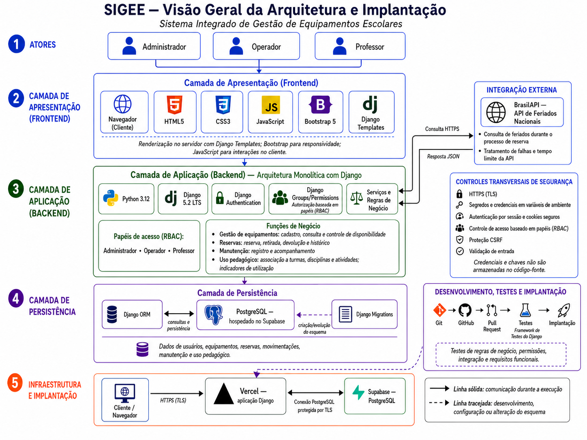

# Arquitetura do sistema

Este documento descreve a arquitetura implementada no SIGEE e sua configuração de implantação.

## Diagrama da arquitetura

## Visão geral

O SIGEE adota uma arquitetura web monolítica com Django e renderização no servidor. Os usuários acessam a mesma aplicação pelo navegador, enquanto o backend centraliza a autenticação, a autorização, as regras de negócio, o acesso aos dados e a geração das páginas HTML.

A solução é organizada em camadas para separar responsabilidades sem introduzir um frontend independente ou uma API própria desacoplada.

| Camada | Tecnologias e responsabilidades |
|---|---|
| Apresentação | Navegador, Django Templates, HTML5, CSS3, Bootstrap 5 servido localmente e JavaScript pontual para a interface e a responsividade. |
| Aplicação | Python 3.12 e Django 5.2 LTS para roteamento, autenticação, autorização, validações e regras de negócio. |
| Persistência | Django ORM para consultar e gravar dados no PostgreSQL, com Django Migrations para controlar a evolução do esquema. |
| Integração externa | BrasilAPI para consultar feriados nacionais nos calendários de reserva e configuração da escola e SMTP configurável para recuperação de senha; `.env.example` apresenta Gmail como provedor. |
| Infraestrutura | Aplicação Django na Vercel e PostgreSQL hospedado no Supabase. |

## Atores e controle de acesso

O SIGEE possui três perfis funcionais: **Administrador**, **Operador** e **Professor**. A autenticação identifica o usuário, enquanto a autorização determina as operações permitidas para seu perfil.

O controle de acesso utiliza os recursos nativos `Django Authentication`, `Groups` e `Permissions`, seguindo o modelo de controle de acesso baseado em papéis, ou RBAC. As permissões são verificadas no servidor, independentemente das opções apresentadas na interface.

## Camada de apresentação

As páginas são renderizadas no servidor por meio de Django Templates. O Django processa a requisição, consulta os dados necessários e devolve o HTML ao navegador. Bootstrap 5 e CSS complementam a apresentação e a responsividade, enquanto JavaScript é empregado somente em interações pontuais no cliente. Bootstrap e fontes são entregues pelos arquivos estáticos do próprio projeto, evitando que o navegador envie metadados a CDNs apenas para renderizar a interface.

Essa decisão mantém a interface integrada ao monólito Django e evita a complexidade de um frontend SPA separado para o escopo do projeto.

## Camada de aplicação

O backend concentra os serviços e as regras relacionadas às principais áreas funcionais:

- gestão de equipamentos, incluindo cadastro, consulta e disponibilidade;
- reservas, retiradas, devoluções e histórico de movimentações;
- registro e acompanhamento de manutenções;
- associação da utilização a turmas, disciplinas e atividades pedagógicas;
- consolidação de indicadores do inventário e da utilização pedagógica.

O app `calendario` mantém `CalendarioEscolar`, regras semanais, faixas de uso e atendimento, exceções por data, histórico de alterações e fechamentos emergenciais. O calendário é único por instalação. `FechamentoEscolar` e `ReservaAfetadaFechamento` preservam os compromissos afetados e a decisão do Administrador; a suspensão impede novas entregas, sem impedir devoluções físicas. As cotas opcionais ficam em `TipoEquipamento`, com configuração pela mesma área administrativa.

No domínio de reservas, `Categoria` classifica os equipamentos, `TipoEquipamento` representa o tipo/modelo escolhido pelo Professor, `Local` identifica o ponto de retirada e `Equipamento` representa cada unidade física patrimonial. A entidade `Reserva` registra uma solicitação em lote para um único tipo/modelo e local; a tabela associativa `ReservaEquipamento` registra as unidades efetivamente alocadas nesse local, permitindo consultar disponibilidade e impedir conflitos por patrimônio.

Cada reserva guarda o calendário confirmado, o intervalo após o uso e a cota vigente na confirmação. Mudanças ordinárias de configuração não reescrevem esses dados. O fechamento emergencial usa um fluxo próprio de decisão. A antecedência de novos agendamentos é de até 15 dias corridos pela data local.

As validações de domínio são executadas no servidor, inclusive quando a requisição não se origina da navegação comum da interface.

O app `pedagogico` mantém os cadastros compartilhados de Turma, Disciplina e Atividade Pedagógica. A reserva exige esse planejamento; a entrega cria uma `UtilizacaoPedagogica` por unidade retirada. O Professor corrige o contexto próprio até a devolução integral e consulta seus registros. A compatibilidade com retiradas antigas sem reserva preserva devolução e histórico, sem permitir novas retiradas diretas. Os indicadores contam usos realizados, não agendamentos. O [fluxo](fluxo-reservas-uso-historico.md) descreve as etapas.

O app `manutencoes` mantém intervenções com estado, responsáveis, datas, equipamento protegido e devolução de origem opcional. Os serviços transacionais integram abertura automática à devolução com problema e mantêm a situação do equipamento coerente com a intervenção. Administrador e Operador abrem manutenção manual; o Administrador inicia e conclui o atendimento.

## Camada de persistência

O Django ORM faz a comunicação entre os modelos da aplicação e o banco de dados. A configuração de implantação usa PostgreSQL hospedado no Supabase como infraestrutura do banco. A autenticação e a autorização permanecem no Django.

As migrations registram a criação e a evolução do esquema. Elas fazem parte do processo de desenvolvimento e implantação, e não da comunicação permanente da aplicação durante seu uso. Na ausência de `DATABASE_URL`, a configuração atual permite SQLite somente para o desenvolvimento local.

## Integração com a BrasilAPI

Ao abrir o calendário da reserva, o frontend solicita ao backend os feriados nacionais do ano exibido para destacá-los com legenda. Datas passadas, além dos 15 dias de antecedência ou fechadas pela escola são desativadas; sábado e domingo dependem da configuração institucional. O seletor de exceções do Administrador permite fins de semana futuros, sem liberar datas passadas. Durante a consulta prévia do período, o backend consulta por HTTPS a API de Feriados Nacionais da BrasilAPI e apresenta o resultado no diálogo de confirmação. O feriado tem caráter informativo, e falhas, indisponibilidade ou tempo limite da integração não impedem a conclusão da reserva.

A consulta é feita pelo backend. O [contrato da BrasilAPI](integracao-brasilapi.md) define validação, timeout e contingência.

## Segurança transversal

Os controles de segurança afetam todas as camadas da solução e incluem:

- comunicação por HTTPS e TLS no ambiente publicado;
- segredos e credenciais armazenados em variáveis de ambiente;
- autenticação por sessão e uso seguro de cookies, com limites padrão de 30 minutos de inatividade e 8 horas desde o login, validados no servidor sem renovação por consultas automáticas;
- bloqueio temporário de tentativas repetidas de login;
- autorização baseada em grupos e permissões;
- proteção CSRF nos fluxos autenticados;
- validação das entradas no servidor;
- registro básico de acessos e ações relevantes para auditoria.

Credenciais, chaves e dados sensíveis não devem ser armazenados no código-fonte nem enviados aos templates ou ao JavaScript do cliente. O inventário dos fluxos e fornecedores está em [Governança e inventário de dados pessoais](../privacidade/governanca-dados-pessoais.md).

## Fluxo principal de uma requisição

De forma resumida, uma operação segue o fluxo:

1. O usuário acessa o SIGEE pelo navegador por uma conexão HTTPS.
2. O Django recebe a requisição, verifica a validade da sessão antes da view e aplica o aceite legal e as permissões correspondentes. Sessões expiradas exigem novo login; consultas JSON recebem 401.
3. O backend valida os dados e executa as regras de negócio.
4. O Django ORM consulta ou atualiza o banco de dados.
5. Quando necessário em uma reserva, o backend consulta a BrasilAPI; na recuperação de senha, usa o SMTP configurado.
6. O Django renderiza o template, resolve os arquivos estáticos locais e devolve a resposta HTML ao navegador.

O fluxo principal pode ser representado por **Usuário → Navegador → Django → Regras de negócio → Django ORM → PostgreSQL**, com a integração complementar **Django ↔ BrasilAPI**.

## Desenvolvimento, testes e implantação

O código é versionado com Git no GitHub. O framework de testes do Django verifica os cenários definidos nos apps. A configuração `config.settings_testes` fixa SQLite em memória e e-mail em memória para os testes locais; concorrência por bloqueio de linha exige PostgreSQL isolado. Os comandos estão no [README](../../README.md#testes).

`vercel.json` configura a região `gru1`. A implantação exige variáveis de ambiente e migrations compatíveis com o código; o arquivo não executa migrations. A configuração de `DATABASE_URL` aceita `sslmode`; a orientação de implantação utiliza `sslmode=require`. O procedimento de [proteção do banco](../implantacao/seguranca-banco-supabase.md) detalha grants, RLS e atualização de bancos existentes.

## Diagramas do domínio

- [Classes do domínio](../diagramas/diagrama-de-classes.png): modelos e principais relacionamentos; operações transacionais ficam nos serviços dos apps.
- [Processo](../diagramas/bpmn.png): reserva, entrega, devolução e manutenção.

## Decisões técnicas principais

| Decisão | Motivo | Trade-off |
|---|---|---|
| Monólito Django com templates | Mantém a solução simples, integrada e compatível com o escopo acadêmico. | Não há frontend separado nem API própria desacoplada. |
| Recursos nativos do Django para autenticação e autorização | Evitam duplicação de mecanismos de identidade e facilitam a aplicação de permissões no servidor. | A configuração de grupos e permissões precisa ser mantida pela própria aplicação. |
| Supabase somente para hospedar o PostgreSQL | Fornece infraestrutura gerenciada para o banco sem alterar o modelo de autenticação definido. | Supabase Auth não é utilizado. A autorização funcional permanece no Django; RLS e grants restringem o acesso das roles da Data API às tabelas internas, conforme a [proteção do banco](../implantacao/seguranca-banco-supabase.md). |
| BrasilAPI como integração não bloqueante | Acrescenta informação sobre feriados sem comprometer o fluxo principal de reserva. | A aplicação precisa tratar falhas e tempo limite e continuar funcionando sem a resposta externa. |
| Vercel como implantação | Mantém a infraestrutura enxuta para o escopo do SIGEE. | Logs, região, suboperadores e migrations precisam ser acompanhados no processo de implantação. |

O início operacional do Operador reutiliza consultas de reservas e movimentações, incluindo a sinalização de compromissos afetados por devoluções anteriores vencidas. A entidade `SubstituicaoReserva` preserva reserva, patrimônios anterior e substituto, manutenção, responsável e data; a alocação atual continua em `ReservaEquipamento`. Entregas complementares produzem movimentações distintas na mesma reserva, com unicidade por reserva e unidade física. A confirmação de comunicação ao Professor é registrada na movimentação da entrega parcial. Quantidades pendentes de entrega são derivadas da quantidade solicitada e das retiradas, separadamente das devoluções em aberto. Meus dados consulta exclusivamente a conta autenticada e está disponível aos três perfis funcionais.
