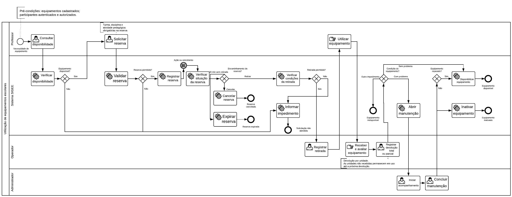

# Fluxo de reservas, uso e histórico

O fluxo organiza o empréstimo em Reservas, Em uso e Histórico. A classificação deriva da situação da reserva e das movimentações, sem um segundo estado de empréstimo mantido manualmente.

## Responsabilidades

| Etapa | Professor | Operador | Administrador |
|---|---|---|---|
| Reservas | Cria e acompanha as próprias reservas, informa contexto e cancela quando permitido | Confere e entrega o lote integral | Consulta |
| Em uso | Consulta seus empréstimos pendentes e corrige o contexto | Registra devoluções parciais ou integrais e problemas por patrimônio | Consulta |
| Histórico | Consulta somente seus registros encerrados | Consulta registros encerrados | Consulta registros encerrados |

## Reserva e entrega

1. O Professor consulta disponibilidade por tipo/modelo, local e período e informa uma quantidade positiva, turma, disciplina e atividade. A observação é opcional.
2. O servidor valida perfil, período, referências ativas, disponibilidade e conflitos; aloca unidades físicas compatíveis e grava uma única reserva com seus itens.
3. O Professor cancela a reserva própria enquanto está ativa, sem retirada e antes de vencer a tolerância. Reservas sem retirada expiram integralmente ao completar 30 minutos do início; a rotina é acionada nos fluxos que sincronizam expiração.
4. O Operador confirma a entrega integral das unidades alocadas ao Professor proprietário. A entrega exige reserva ativa, contexto completo e equipamentos ativos e disponíveis, a partir do início e antes de completar a tolerância.
5. A transação grava retiradas, situações `EM_USO`, utilizações pedagógicas por unidade e auditoria. Repetição da entrega é rejeitada. O lote passa para Em uso.

Toda nova retirada exige reserva. As rotas e o serviço antigos de retirada sem reserva recusam novas operações. O fim do horário agendado não representa devolução física nem encerra o empréstimo.

## Devolução

Qualquer Operador autorizado recebe todas ou parte das unidades, mesmo quando outro Operador registra a entrega. A confirmação preserva equipamento, destinatário, reserva, lote e retirada de origem de cada unidade. Seleção vazia, repetida, de outro grupo ou já devolvida é rejeitada sem gravação parcial.

Cada devolução referencia uma única retirada; uma restrição no banco impede duplicidade. Movimentações, atualização dos equipamentos, auditoria e eventual manutenção são atômicas. Falha desfaz toda a confirmação. As unidades não recebidas continuam pendentes.

Unidade ativa sem impedimento retorna a `DISPONIVEL`. Equipamento inativo não é reativado pela devolução; equipamento já em manutenção mantém a situação. Um problema informado exige descrição e abre manutenção pendente por patrimônio. A devolução com problema encerra a pendência física daquela unidade, enquanto a intervenção segue sob responsabilidade do Administrador.

## Manutenção

O Administrador também abre manutenção manualmente para unidade ativa e disponível. Existe no máximo uma intervenção pendente ou em andamento por equipamento. A intervenção registra origem opcional na devolução, problema, responsáveis e datas.

O ciclo é `PENDENTE` → `EM_ANDAMENTO` → `CONCLUIDA`. A conclusão exige descrição da solução ou da análise e resultado: `REPARADO` atualiza a situação para `DISPONIVEL`, sem desfazer uma inativação independente; somente a unidade ativa volta a ficar disponível para uso. `SEM_REPARO` inativa o equipamento e preserva seu histórico. A situação do equipamento e a intervenção são atualizadas na mesma transação.

## Contexto e indicadores pedagógicos

Turma, Disciplina e Atividade Pedagógica são cadastros compartilhados mantidos pelo Administrador, com nome único, situação e data de criação; atividade também possui descrição opcional. Há consulta, criação, edição, inativação e reativação, sem exclusão definitiva. Não há cadastro de alunos. Nomes atuais são exibidos pelos vínculos; não há snapshot dos textos.

O Professor corrige o planejamento de reserva própria ativa antes de vencer a tolerância. Após a entrega, corrige o contexto enquanto há pelo menos uma unidade pendente. A devolução parcial permite atualizar também as unidades já devolvidas do lote e sincroniza a reserva; a devolução integral encerra criação e edição. Novas escolhas exigem cadastros ativos, mas uma referência já vinculada pode ser mantida após inativação.

`UtilizacaoPedagogica` possui vínculo único e protegido à movimentação de retirada. Cada registro representa uma unidade física. A devolução consulta o contexto da retirada original, sem copiá-lo. Gravações e auditorias são transacionais; reenvio sem alteração das utilizações não duplica registros nem seus eventos de sucesso.

O agendamento não aumenta os indicadores. As utilizações efetivas entram no cálculo após a retirada: utilizações contam grupos por reserva, lote ou retirada individual legada; retiradas contam unidades movimentadas; equipamentos distintos contam patrimônios sem duplicação dentro do agrupamento. Devolução e inativação de cadastros preservam as contagens históricas.

## Histórico e registros anteriores

`ReservaQuerySet.com_etapa()` classifica a reserva como `AGUARDANDO`, `EM_USO`, `ENCERRADA`, `CANCELADA` ou `EXPIRADA`, a partir das retiradas e devoluções. O campo persistido `status` contém somente `ATIVA`, `CANCELADA` e `EXPIRADA`; uma reserva entregue pode continuar com `status=ATIVA` e aparecer encerrada pela classificação derivada.

O Histórico apresenta reservas devolvidas integralmente, canceladas ou expiradas, mesmo sem movimentações, além de legados encerrados sem reserva. A busca inclui Professor, Operador, tipo/modelo e patrimônio. O período considera as movimentações; sem retirada, considera a data reservada. O Professor consulta somente seus registros, com propriedade aplicada antes dos filtros e da paginação. Consultar Em uso não autoriza entregar ou devolver.

Retiradas antigas sem reserva permanecem com suas referências originais. As pendências aceitam devolução; lotes encerrados ficam identificados no Histórico. O Professor destinatário registra ou corrige o contexto enquanto há unidade pendente. Um UUID identifica os lotes existentes; sem UUID e sem reserva, a utilização pedagógica trata cada retirada como individual. O agrupamento de pendências anteriores por destinatário não comprova um lote histórico único.

Reservas antigas sem contexto precisam ser completadas pelo Professor antes da entrega. As migrations `reservas.0005` e `0006` recuperam somente contextos históricos uniformes e exigem contexto completo ou totalmente ausente; não inventam utilizações. As precauções de atualização estão em [Implantação](../implantacao/seguranca-banco-supabase.md#atualização-de-bancos-existentes).

## Integridade e referências

Os serviços usam transações e bloqueios de linha. Nas reservas vinculadas, a ordem de bloqueio começa pela reserva e segue pelas retiradas; a criação serializa a reserva com a inativação do Professor. SQLite não comprova esses bloqueios; os testes concorrentes exigem PostgreSQL isolado.

As regras estão em [Regras de negócio](../requisitos/regras-de-negocio.md), e as permissões em [Matriz de acesso](matriz-de-acesso.md). A implementação está em `reservas/models.py`, `reservas/services.py`, `reservas/consultas.py`, `movimentacoes/services.py`, `manutencoes/services.py` e `pedagogico/services.py`. O [README](../../README.md#testes) reúne os comandos de verificação.

Administrador e Operador consultam o escopo global; não há isolamento por instituição. O Professor permanece restrito aos próprios registros.
